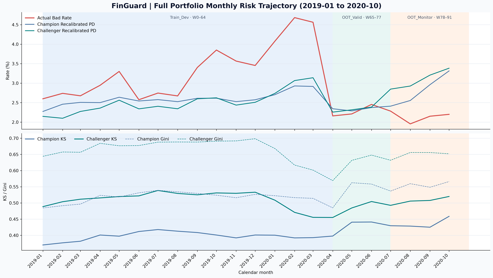
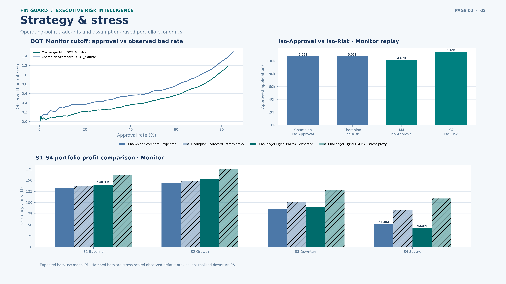
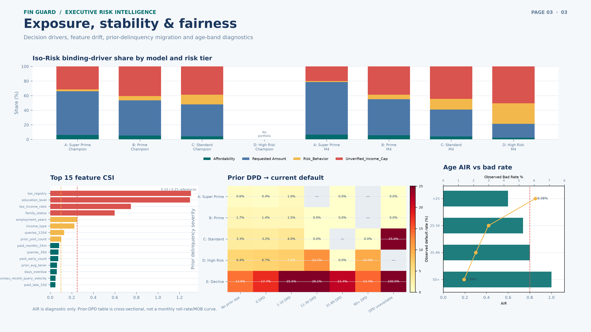
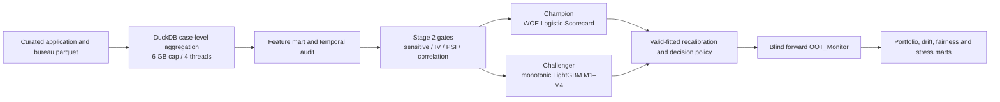

# FinGuard | Credit Decisioning & MRM Prototype

> 🚀 **Live Interactive Workbench (Zero-Install Web App)**
> **[Launch FinGuard Credit Decisioning & MRM Workbench →](https://finguard-credit-risk.netlify.app/)** — interactive dual-model inference (`19-feature Scorecard` + `73-feature LightGBM M4`), 3-driver DSR limit waterfall, KGB reject-bias sensitivity (`k* = 2.99×`), and MRM drift remediation (`M4-NoDrift`).


**A retrospective credit decisioning and model-risk-management (MRM) prototype for Malaysian and Southeast Asian fintech.** FinGuard builds a transparent WOE scorecard and a monotonic LightGBM challenger. Canonical Champion and M4 Full evaluations keep OOT_Monitor blind; M4-NoDrift is a separately labeled post-hoc sensitivity because its feature exclusions use Monitor CSI.

> **Scope:** retrospective portfolio case study using historical observed loan outcomes. Simulated approvals and profit are assumptions-based comparisons, not causal treatment effects, legal advice, or production approval.

## Executive dashboard preview

<p align="center">
  
  
  
</p>

- [Open the standalone interactive command center](dashboard/FinGuard_Interactive_Command_Center.html)

## At a glance

| Result | Verified finding |
|---|---|
| Portfolio | 1,526,659 historical application-level records from the Home Credit 2024 dataset; historical decision window 2019-Q1 to 2020-Q4; OOT_Monitor covers 2020-06-30 to 2020-10-05; overall observed bad rate 3.1437% |
| Temporal design | **1,292,350 Dev** (Train_Dev W0–64) \| **82,602 Valid** (OOT_Valid W65–77) \| **151,707 Monitor** (OOT_Monitor W78–91) |
| Champion | 19-feature WOE Logistic Scorecard; OOT_Valid `ROC-AUC=0.7768`, `KS=0.4346`; OOT_Monitor `KS=0.4222` |
| Challenger | 73-feature monotonic LightGBM M4; OOT_Valid raw `ROC-AUC=0.8173`, `KS=0.4929`; OOT_Monitor `KS=0.5006` |
| Incremental lift | OOT_Valid KS rises from M1 `0.3236` to M4 `0.4929` across four feature-group additions |
| Forward Iso-Risk comparison | Monitor approval `70.7970% → 75.1587%` (+6,617 cases); observed bad rate `0.9990% → 0.8832%`. Under unified `Intercept-Recalibrated PD`, Stage 6 S1 Baseline Model-Implied Scenario Expected Net Profit Proxy (not realized lifecycle profit): Champion `133.66M` (`133,659,752`) → Challenger `142.31M` (`142,305,881`), uplift `+8.65M` (`+8,646,129`, `+6.47%`). |
| MRM remediation | M4-NoDrift is a post-hoc drift-remediation sensitivity analysis: 4 exclusions were informed by Train_Dev vs OOT_Monitor CSI, so its Monitor metrics are not an independent blind OOT validation. Score PSI 0.0772 → 0.0069; KS 0.5006 → 0.5001. Promotion requires a subsequent mature-window independent validation or Shadow Mode. |
| Reject-bias sensitivity | k* = 2.99× break-even sensitivity; this is not an estimate of unobserved reject outcomes |
| Governance | No synthetic MOB curves: prior-contract DPD severity migration used because source table lacks monthly snapshots |

## Why the result matters

- **Risk-adjusted growth:** at a frozen Iso-Risk operating point, the challenger approved more Monitor cases with a lower observed bad rate. The expected-net-profit difference is a deterministic simulation, not causal realized impact.
- **Feature evidence:** four-group ablation quantifies sequential ranking lift; Group 4 includes explicitly flagged unstable proxies, so its incremental contribution needs stability review.
- **Calibration is temporal:** the W55–64 calibration slice had 4.64% bad rate versus 2.34% on OOT_Valid. A one-window isotonic mapping did not transport perfectly, motivating separate calibration and monitoring controls.
- **Honest portfolio analytics:** the source lacks consecutive monthly DPD snapshots. Stage 6 therefore reports prior-DPD migration and stress proxies, not fabricated MOB curves or realized downturn P&L.
- **Fairness and data limits:** sensitive predictors were excluded; gender is 99.26% unknown on Monitor, and the under-25 AIR diagnostic is investigated alongside observed risk and calibration.

## Architecture



## Selected visuals and documentation

- [Temporal cohort trend](reports/figures/stage6_cohort_vintage_trend.png) · [Exposure concentration](reports/figures/stage6_exposure_concentration.png) · [Stress scenarios](reports/figures/stage6_stress_scenarios.png)
- [Stage 5 calibration comparison](reports/figures/stage5_calibration_before_after.png) · [Top CSI drift](reports/figures/stage5_top_csi_drift.png)
- [Model Development & Validation Document](docs/Model_Development_and_Validation_Document_MDVD.md)
- [Stage 6 Power BI dashboard blueprint](reports/powerbi_dashboard_blueprint.md) · [Stage 6 portfolio and scenario report](reports/stage6_portfolio_and_scenarios_report.md)
- [Senior modeller interview defense guide](reports/mha_interview_defense_guide.md)

## Repository map

```text
FinGuard/
├── data/
│   ├── powerbi/                 # six aggregated, non-PII CSV marts (tracked)
│   └── processed/               # selected-feature and scorecard outputs (allowlisted)
├── dashboard/screenshots/       # reviewed non-sensitive screenshots only
├── docs/                        # formal MDVD
├── reports/                     # stage reports, blueprint, figures, interview guide
├── sql/                         # Stage 1A DuckDB source-table audit
├── src/                         # Stage 1A–6 executable pipeline
├── duckdb_temp/                 # local spill; ignored
├── requirements.txt             # pinned verified runtime dependencies
└── README.md
```

## Reproducibility

1. Use Python 3.12 and install the pinned packages: `python -m pip install -r requirements.txt`. The working project environment was verified at `D:\data analysis\FinGuard\.venv\Scripts\python.exe`; recreate it locally rather than copying it.
2. Obtain the source dataset through its authorized source account and place raw files under the expected `data/parquet_files/` layout. Raw data and credentials are intentionally excluded from Git. Do not commit `*kaggle.json` or private application records.
3. Run pipeline scripts in stage order after checking each script's input paths and `AGENTS.md` resource limits:

   | Stage | Entry point |
   |---|---|
   | 1A | `src/audit_stage1a.py` and `sql/01_depth0_base_static.sql`–`04_depth1_demographics_and_alt_proxies.sql` |
   | 1B | `src/build_feature_mart_stage1b.py` |
   | 2 | `src/feature_selection_stage2.py` |
   | 3 | `src/train_models_stage3.py` |
   | 4 | `src/credit_decision_stage4.py` |
   | 5 | `src/monitoring_recalibration_stage5.py` |
   | 6 | `src/portfolio_scenarios_powerbi_stage6.py` |

   Exact CLI names and prerequisites are documented in each script and corresponding `reports/stage*_*.md`. Outputs depend on the licensed/source dataset and deterministic package/platform behavior; no raw dataset is bundled here.

4. Review split boundaries before running any fitting code. For canonical Champion and M4 Full, `OOT_Valid` was used for Stage 5 recalibration/cutoff selection and `OOT_Monitor` remained blind (`monitor_used_for_fit_or_selection: false`). M4-NoDrift is an exception: its post-hoc feature exclusion was informed by `Train_Dev vs OOT_Monitor` CSI, so it is not an independent blind OOT validation.

### Data and model governance

The repository intentionally tracks reviewed code, documentation, figures and aggregated portfolio marts, while ignoring raw parquet, processed row-level parquet, serialized models, local spills, virtual environments and credentials. A successful Git ignore check is not a data privacy review. Confirm aggregation, small-cell risk and applicable permissions before publishing portfolio exports.

The live Netlify URL serves standalone zero-backend browser inference. `FastAPI` in `api/decision.py` is a local inference prototype that requires locally generated model `.pkl` artifacts, which are excluded via `.gitignore`. The Malaysia section is a conceptual regulatory framework mapping (BNM Responsible Financing, CCRIS / CTOS, and MFRS 9), not a compliance certification or a full ECL engine. The Stage 4 APR, DSR, LGD and cost values are project assumptions, not blanket statutory caps. Confirm entity/product scope with compliance counsel. See the [MDVD regulatory and limitations register](docs/Model_Development_and_Validation_Document_MDVD.md#10-limitations-register--production-governance).

## 中文简介

FinGuard 是面向马来西亚与东南亚金融科技场景的消费信贷风险案例：以时间切分构建 WOE 逻辑回归计分卡及单调 LightGBM challenger，并评估概率校准、额度策略、漂移、公平性和压力情景。所有业务利润与压力数值均为明确假设下的模拟，不能解释为因果效果或生产批准；原始数据及个人级记录不随仓库发布。
# FinGuard Risk OS v2.0 architecture

```text
api/                     FastAPI underwriting and batch service
configs/                 Versioned decision policy and JSON Schema
src/                     Stage pipelines, web app builder, browser QA
.github/workflows/ci.yml Lightweight syntax, policy, and API contract CI
docs/index.html          Seven-view executive Risk OS web app
dashboard/               Interactive dashboard and audit screenshots
tests/                   16 local artifact invariants + data-independent CI contracts
```

The hosted workflow intentionally avoids the large local parquet/model artifacts; run the full 16-test suite and Playwright QA from the verified local `.venv` checkout.
